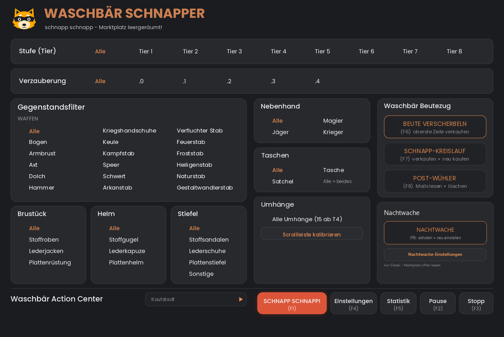
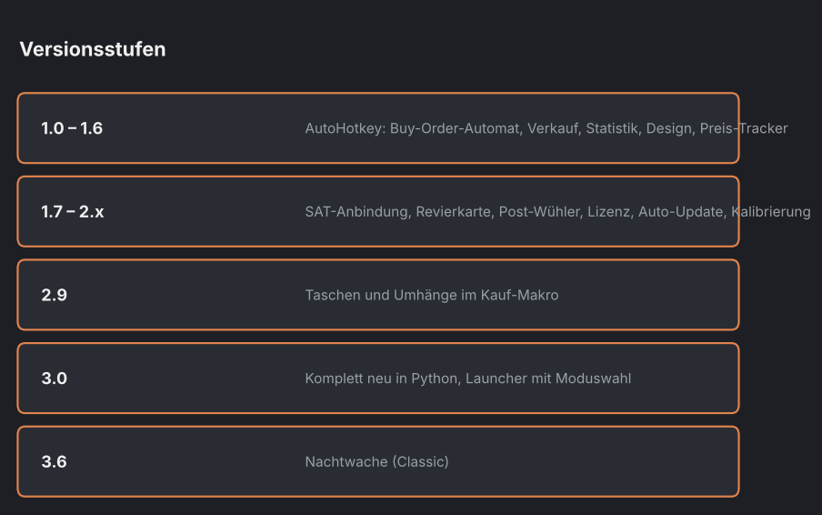

# Waschbär Schnapper – Dokumentation

**Windows-Programm für den Marktplatz in Albion Online.** Es automatisiert wiederkehrende Klickfolgen beim Einstellen von Kaufaufträgen (Buy Orders) und beim Verkaufen, liest Ergebnisse aus und führt Buch über Käufe, Verkäufe und Gewinn.

> Dieses Repository enthält **nur Dokumentation**: keinen Quellcode, keine Programmdateien, keine Lizenzlogik. Die Software steht unter einer eigenen Lizenz („Alle Rechte vorbehalten, nur private Nutzung“).

## Inhalt

| Seite | Thema |
|---|---|
| [docs/funktionen.md](docs/funktionen.md) | Alle Funktionen und Hotkeys im Detail |
| [docs/einstellungen.md](docs/einstellungen.md) | Einstellungsfenster, Optionen, Auflösung |
| [docs/kalibrierung.md](docs/kalibrierung.md) | Kalibrierung per Screenshot |
| [docs/statistik.md](docs/statistik.md) | Statistik, SAT-Anbindung, Preis-Tracker, Export |
| [docs/safe-modus.md](docs/safe-modus.md) | Safe-Modus einrichten (Raspberry Pi Pico) |
| [docs/hwinput.md](docs/hwinput.md) | Eingabe-Bibliothek (Backends: Pico, SendInput) |
| [docs/nachtwache.md](docs/nachtwache.md) | Nachtwache (F9) im Classic-Modus |
| [docs/launcher-und-updates.md](docs/launcher-und-updates.md) | Launcher, Lizenzprüfung, Auto-Update |
| [docs/architektur.md](docs/architektur.md) | Aufbau der Programmteile und Ordnerstruktur |
| [docs/versionsverlauf.md](docs/versionsverlauf.md) | Vollständiger Versionsverlauf 1.0 bis 3.6 |
| [docs/fehlerbehebung.md](docs/fehlerbehebung.md) | Häufige Probleme |

## Auf einen Blick

- **Kaufen (F1):** Buy Orders für gewählte Waffen, Rüstungsteile, Taschen und Umhänge, gefiltert nach Tier (1 bis 8) und Verzauberung (.0 bis .4).
- **Beute verscherbeln (F6)** und **Schnapp-Kreislauf (F7):** Verkaufen und neu einstellen, mit einstellbarer Zahl an Durchläufen.
- **Post-Wühler (F8):** liest Mails im Postfach und löscht sie.
- **Nachtwache (F9, nur Classic):** holt fertige Verkäufe ab und stellt Items neu ein.
- **Statistik (F5):** sechs Tabs mit Wühlkasse, Chroniken, Revierkarte, Beute-Charts und Updatelog.
- **Kalibrierung:** Auflösung und UI-Skalierung werden aus Screenshots ermittelt.
- **Launcher:** Lizenz, Programmvariante, Online-Prüfung und automatisches Update.

## Entwicklung in Stufen

Das Projekt begann als AutoHotkey-Skript (Version 1.0, Buy-Order-Automat) und wuchs über Statistik, Design, Preis-Tracker, SAT-Anbindung, Lizenz und Auto-Update. Mit Version 3.0 wurde es komplett in Python neu geschrieben. Der Classic-Modus mit dem ursprünglichen AutoHotkey-Programm blieb erhalten, weil die Nachtwache dort läuft. Details stehen im [Versionsverlauf](docs/versionsverlauf.md).

## Systemvoraussetzungen

- Windows mit Albion Online
- Bildschirmauflösung und Windows-Skalierung, die die Kalibrierung unterstützt (siehe [Kalibrierung](docs/kalibrierung.md))
- Optional: das Statistics Analysis Tool (SAT) für Handelsdaten
- Internetverbindung für die Lizenzprüfung (siehe [Launcher und Updates](docs/launcher-und-updates.md))

