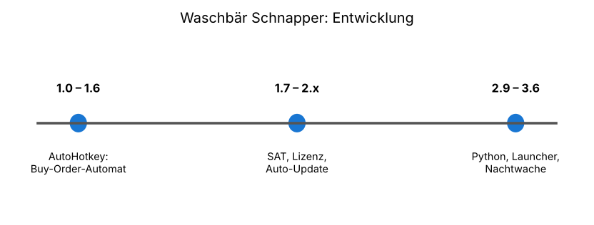

# Waschbär Schnapper – Dokumentation

Dokumentation zu einem **Windows-Programm für den Marktplatz in Albion Online**. Es automatisiert wiederkehrende Klickfolgen beim Einstellen von Kauf- und Verkaufsaufträgen und wertet die Ergebnisse aus. Dieses Repository enthält **nur die Beschreibung**: keinen Quellcode, keine Lizenzlogik, keine Programmdateien.

> Die Software steht unter einer eigenen, restriktiven Lizenz („Alle Rechte vorbehalten, nur private Nutzung“). Diese Dokumentation beschreibt sie nur.

## Entwicklung in Stufen

| Version | Stand |
|---|---|
| 1.0 bis 1.6 | AutoHotkey-Skript: Buy-Order-Automat mit Kategorien, Tiers und Verzauberungen, Statistik, Bildoberfläche, Preis-Tracker |
| 1.7 bis 2.x | Anbindung an das Statistics Analysis Tool (SAT), Revierkarte aus Spiel-Mails, Post-Wühler, Online-Lizenzprüfung, Auto-Update über GitHub, Kalibrierung per Screenshot |
| 2.9 bis 3.6 | Taschen und Umhänge im Kauf-Makro, komplett neu in Python mit Launcher und zwei Modi, „Nachtwache“ per Windows-OCR |

## Überblick

## Funktionen

- **Kaufen:** Buy Orders für ausgewählte Kategorien, Tiers und Verzauberungen, inklusive Taschen und Umhängen
- **Beute verscherbeln (F6)** und **Schnapp-Kreislauf (F7):** Verkaufs- und Neueinstellungsabläufe mit einstellbaren Durchläufen
- **Post-Wühler (F8):** arbeitet Mails im Postfach ab
- **Nachtwache (F9, nur Classic):** holt in einstellbaren Zyklen fertige Verkäufe ab, erstellt Buy Orders und stellt Items neu ein; bei Preis 0 wird der Durchschnitt aus der 4-Wochen-Historie eingetragen
- **Pause/Fortsetzen (F2), Stopp (F3), Einstellungen (F4), Statistik (F5)**
- **Statistik** mit mehreren Tabs: Wühlkasse, Verscherbel-Chronik, Kreislauf-Kapriolen, Revierkarte, Beute-Charts, Updatelog. Export und Import als Textdatei, Mail-Archiv als CSV.
- **Preis-Tracker:** höchste Buy-Order-Preise nach jedem Lauf, Silbersumme, Preise aus SAT oder Data Project
- **Kalibrierung per Screenshot:** Auflösung und UI-Skalierung werden aus Beispielbildern erkannt, statt manuell gewählt
- **Laufzeitschätzung** vor dem Start aus gemessenen Zeiten

## Programmteile (Version 3)

- **Launcher:** Startbildschirm mit Modusauswahl, Lizenzanmeldung per Geräte-ID, Versionsprüfung, automatischem Update mit Prüfsumme und Pflicht-Updates
- **Classic-Modus:** das ursprüngliche AutoHotkey-Programm als EXE
- **Python-Modus:** Neuimplementierung mit Oberfläche, Engine, Statistik und Kalibrierung, samt Unit-Tests
- **Admin-Panel** (nur für den Autor): Lizenzverwaltung und Veröffentlichen von Releases

## Voraussetzungen

Windows, Albion Online, optional das SAT-Tool für Handelsdaten. Die Oberfläche passt sich der Windows-Skalierung an.

## Hinweise

- Das Programm klickt selbstständig im Spiel. Prüfe vor der Nutzung, ob die Nutzungsbedingungen von Albion Online das erlauben. Die Lizenz des Programms schließt eine Haftung für Kontosperren aus.
- Zugangsdaten, Lizenzschlüssel und Tokens gehören nie in ein Repository.
