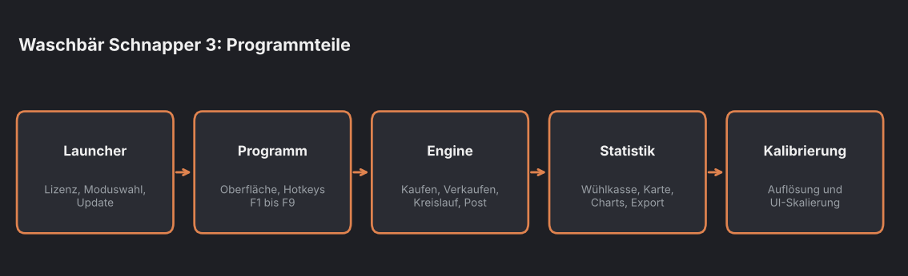

# Architektur



## Python-Version (ab 3.0)

| Teil | Aufgabe |
|---|---|
| **Launcher** | Startbildschirm: Lizenz, Programmvariante, Download mit SHA-256, Start |
| **Programm** | Hauptfenster, Einstellungen, Hotkeys F1 bis F8, Lizenzprüfung |
| **Engine** | Koordinaten und Skalierung, alle Kauf-, Verkaufs-, Kreislauf- und Post-Routinen, Sitzungen, Zeitschätzung |
| **Statistik** | Läufe, SAT-Daten, Preis-Tracker, Export und Import |
| **Kalibrierung** | Messung per numpy, Assistenten |
| **Konfiguration** | Item-Definitionen, Einstellungsdatei (kompatibel zur AutoHotkey-Version), Katalog |
| **Pico-Einrichtung** | Firmware schreiben, Laufwerk erkennen, Einrichtungsfenster |
| **Eingabe-Backend** | Abstraktionsschicht für Tastatur- und Mauseingaben (hwinput) |
| **Tests** | Unit-Tests für Engine, Statistik, Kalibrierung und Launcher |

Die Oberfläche ist in der Python-Version eine schlichte Tk-Oberfläche. Das Bild-Overlay der AutoHotkey-Version wird dort nicht verwendet.

## Eingabe-Backends (hwinput)

Je nach gewählter Programmvariante sendet das Programm die Eingaben auf unterschiedlichem Weg:

| Variante | Backend | Beschreibung |
|---|---|---|
| Classic | Windows SendInput | Windows-API, direkt an das Betriebssystem |
| Safe | Pico (USB-HID) | Über den Raspberry Pi Pico, der als echtes HID-Gerät erscheint |

Ein früherer Kernel-Treiber (Virtual HID Framework) wurde entfernt. Der Pico ersetzt ihn vollständig. Einrichtung: [Safe-Modus](safe-modus.md).

## Classic (AutoHotkey)

Das ursprüngliche Programm in einer Datei mit mehreren Bibliotheken (Kalibrierung, Umhänge, Nachtwache, Update, Lizenz). Die Oberfläche ist ein Bild-Overlay: Hintergrundbilder plus Layout-Dateien und Häkchen-Grafiken.

## Ordnerstruktur der Entwicklung

```
current\
├─ app\          Python-Quellcode (Programm und Launcher), Tests, Assets
│   ├─ hwinput\  Eingabe-Bibliothek (Backends: Pico, SendInput)
│   └─ pico_uf2\ CircuitPython-Firmware für Pico und Pico 2
├─ classic\      Classic-Modus (AutoHotkey)
├─ admin\        nur für den Autor: Lizenzen und Releases
├─ userversion\  fertige Kunden-Dateien und Build
├─ releases\     veröffentlichte Versionen
└─ archiv\       alte AutoHotkey-Version, Backups, Testläufe
```

## Build und Release

Ein einziger Build erzeugt Launcher, Programm und Admin-Panel. Danach übernimmt das Admin-Panel die Dateien aus dem Build-Ordner und veröffentlicht sie. Kunden erhalten nur die fertigen Programmdateien.

## Eigene Daten

Beim Entwickeln liegen Einstellungen, Lizenz, Läufe und Mail-Archiv neben dem Programm. Das ist die Entwicklungsumgebung und gehört nicht zu den Kunden-Dateien.
