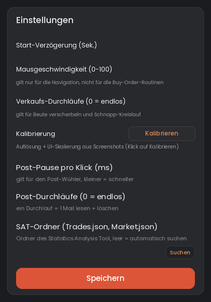

# Einstellungen (F4)

| Option | Bedeutung |
|---|---|
| **Start-Verzögerung (Sek.)** | Wartezeit zwischen Tastendruck und Beginn eines Laufs, damit das Spielfenster in den Vordergrund gebracht werden kann |
| **Mausgeschwindigkeit (0–100)** | Gilt nur für die Navigation, nicht für die Buy-Order-Routinen |
| **Verkaufs-Durchläufe (0 = endlos)** | Gilt für Beute verscherbeln und Schnapp-Kreislauf |
| **Kalibrierung** | Startet die Kalibrierung per Screenshots, siehe [Kalibrierung](kalibrierung.md) |
| **Post-Pause pro Klick (ms)** | Pause im Post-Wühler, kleiner bedeutet schneller |
| **Post-Durchläufe (0 = endlos)** | Ein Durchlauf entspricht einer Mail lesen und löschen |
| **SAT-Ordner** | Ordner des Statistics Analysis Tool mit Trades.json und Market.json. Leer bedeutet automatisch suchen |

Gespeichert werden die Werte in der Datei `swag_settings.ini`. Sie ist zwischen der AutoHotkey- und der Python-Version kompatibel.

## Eingabefelder

Eingabefelder zeigen dunkle Schrift auf hellem Grund (in Version 2.2 behoben, vorher waren sie unleserlich).

## Auflösung und Skalierung

Frühe Versionen hatten ein manuelles Auflösungs-Dropdown mit festen Umrechnungsfaktoren (zum Beispiel für 1920×1080 und 2560×1440). Das fiel in Version 2.8 weg: Auflösung und UI-Skalierung werden jetzt aus Screenshots gemessen. Bei Windows-Skalierung über 100 Prozent passt sich die Oberfläche an (Korrektur in Version 2.5).
