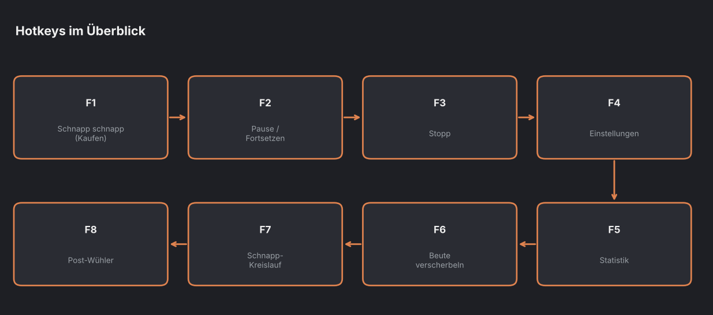

# Funktionen

## Hotkeys

| Taste | Funktion |
|---|---|
| F1 | **Schnapp schnapp:** Buy-Order-Automat mit den gewählten Filtern starten |
| F2 | Pause und Fortsetzen |
| F3 | Stopp. In der Python-Version beendet F3 das Programm nach sofortigem Abbruch des Laufs |
| F4 | Einstellungen |
| F5 | Statistik |
| F6 | Beute verscherbeln, oberste Zeile verkaufen |
| F7 | Schnapp-Kreislauf: verkaufen und neu kaufen |
| F8 | Post-Wühler: Mails lesen und löschen |
| F9 | Nachtwache (nur Classic) |

F6 und F7 sind **Umschalter**: Ein zweiter Druck stoppt den Lauf wieder.

## Kaufen (F1)

Das Hauptfenster bietet Filter in mehreren Gruppen:

- **Stufe (Tier):** Alle oder Tier 1 bis Tier 8
- **Verzauberung:** Alle oder .0 bis .4
- **Gegenstandsfilter, Waffen:** Bogen, Armbrust, Axt, Dolch, Hammer, Kriegshandschuhe, Keule, Kampfstab, Speer, Schwert, Arkanstab, Verfluchter Stab, Feuerstab, Froststab, Heiligenstab, Naturstab und Gestaltwandlerstab. Die Reihenfolge entspricht dem Spielmenü.
- **Nebenhand:** Magier, Jäger, Krieger
- **Rüstung:** Brustteil (Stoffroben, Lederjacken, Plattenrüstung), Helm (Stoffgugel, Lederkapuze, Plattenhelm), Stiefel (Stoffsandalen, Lederschuhe, Plattenstiefel, Sonstige)
- **Taschen:** Tasche, Satchel (Satchel of Insight) oder beide in einem Durchlauf
- **Umhänge:** 15 Stück ab Tier 4

Vor dem Start schätzt das Programm die **Laufzeit** aus gemessenen Zeiten der gewählten Items.

### Umhänge

Umhänge erfordern Scrollen in der Liste. Das Programm klickt dafür auf die Scrollleiste, statt zu ziehen, und misst den Scroll-Stand beim Kauf per Screenshot nach, um Abweichungen zu korrigieren. Die Scrollleiste wird einmalig kalibriert (Button im Umhänge-Feld).

## Waschbär Beutezug

Drei Tasten im gleichnamigen Kasten:

### Beute verscherbeln (F6)
Verkauft die oberste Zeile im Inventar der Reihe nach. Die Zahl der Durchläufe ist einstellbar (0 bedeutet endlos).

### Schnapp-Kreislauf (F7)
Verkauft Items und kauft sie anschließend neu. Auch hier ist die Zahl der Durchläufe einstellbar.

### Post-Wühler (F8)
Klickt eine Mail an und löscht sie, in einer Schleife. Er klickt auf eine der unteren Mails (Zeile 7) statt auf die erste, das ist schneller. Einstellbar sind die **Pause pro Klick** (in Millisekunden, kleiner bedeutet schneller) und die **Durchläufe** (ein Durchlauf entspricht einer Mail lesen und löschen, 0 bedeutet endlos). Die Skalierung kommt aus dem Postfach-Screenshot der Kalibrierung.

## Preis-Tracker

Im Hauptfenster wird die **Kaufstadt** gewählt (ein Klick schaltet zur nächsten Stadt). Nach jedem Kauf-Lauf holt das Programm die höchsten Buy-Order-Preise und berechnet die Silbersumme. Die Preise kommen zuerst aus der Datei Market.json des SAT, danach aus dem Data Project. In der Python-Version läuft zusätzlich ein Hintergrundjob, der alle 60 Sekunden aktualisiert.

## Hinweise zur Bedienung

- Das Spiel muss sichtbar im Vordergrund sein und das Marktfenster offen.
- Nach einer Änderung der Windows-Skalierung oder der Auflösung die Kalibrierung neu durchführen.
- Die Statistik (F5) zeigt alle Läufe, siehe [Statistik](statistik.md).
