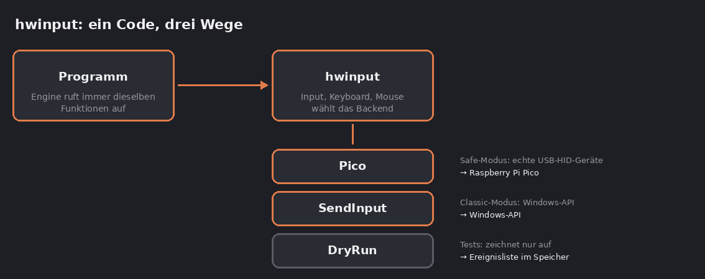
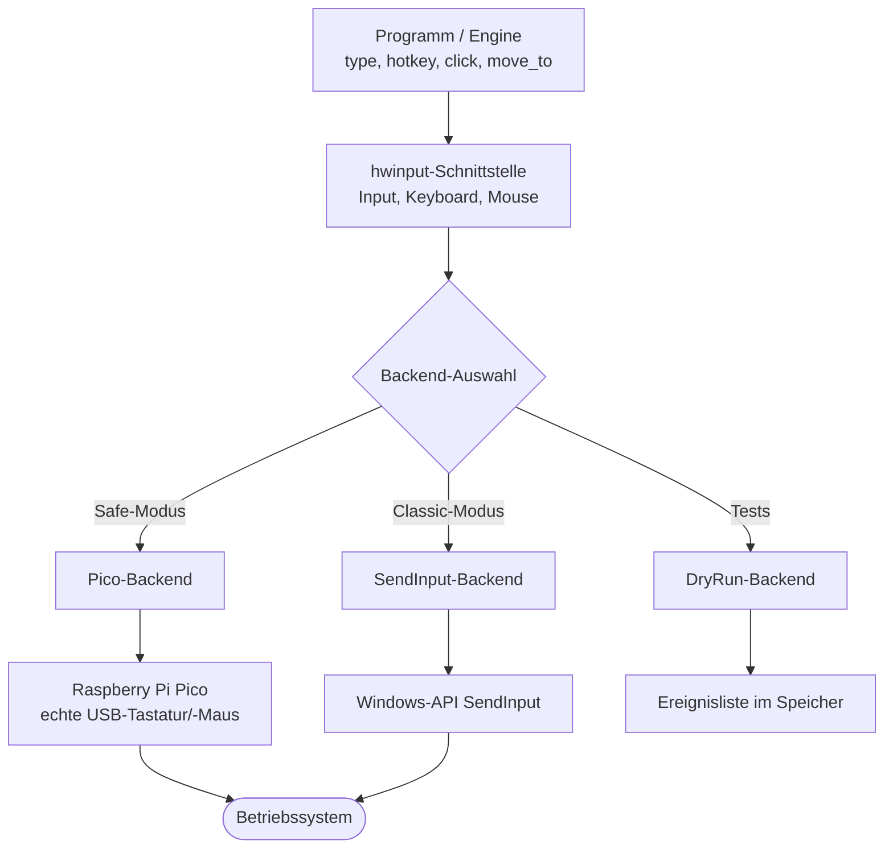
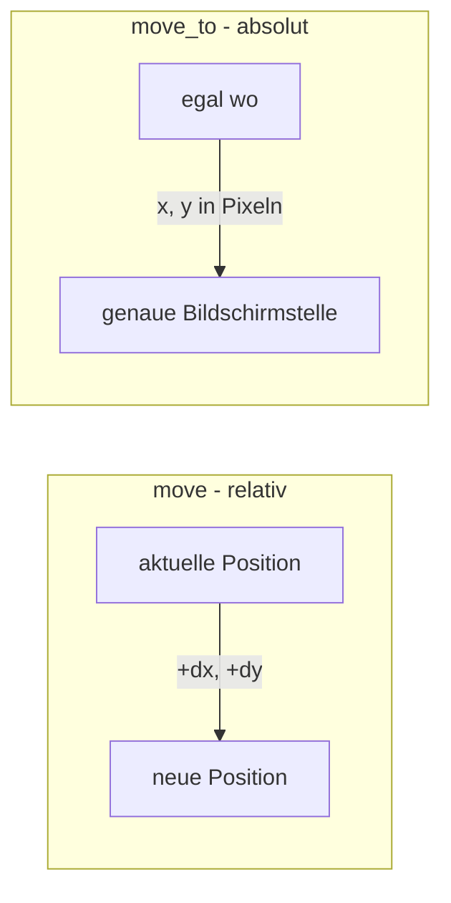
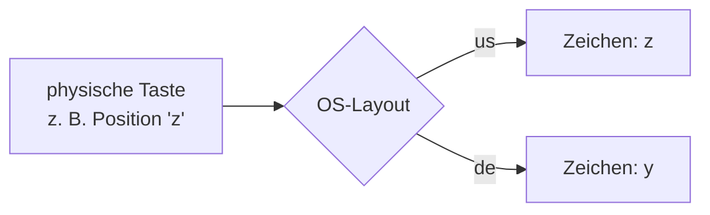
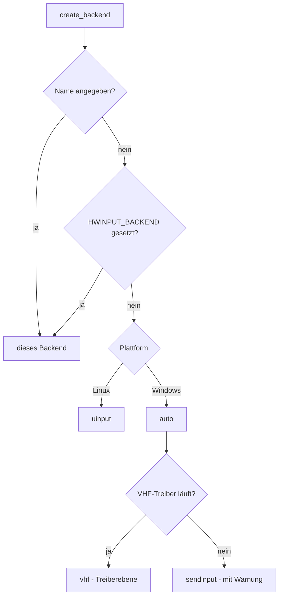
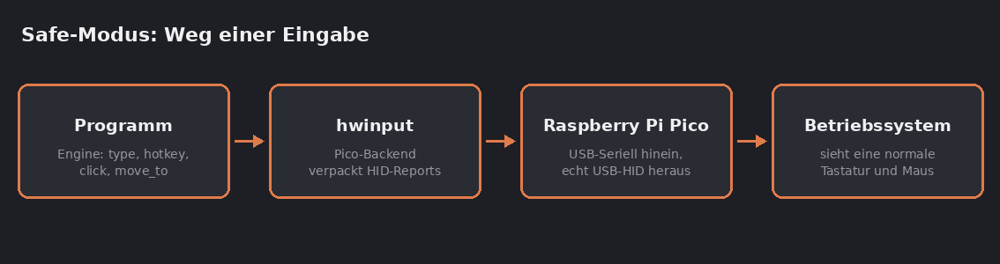
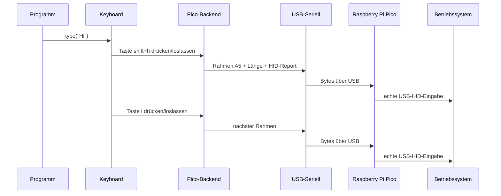
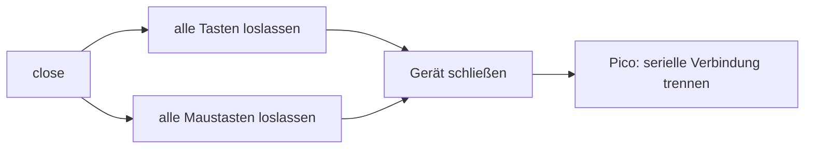

# hwinput



`hwinput` ist die Eingabe-Bibliothek der Python-Version. Sie bündelt Tastatur- und Mauseingaben hinter einer einheitlichen Schnittstelle, sodass der Rest des Programms nicht wissen muss, auf welchem Weg die Eingaben tatsächlich beim Betriebssystem ankommen.

## Grundidee

Das Programm ruft immer dieselben Funktionen auf (`type`, `hotkey`, `click`, `move_to`, ...). Welches Backend die Eingaben dann wirklich sendet, entscheidet `hwinput` je nach Programmvariante und Betriebssystem. Dadurch ist der Classic-Weg (Windows SendInput) und der Safe-Weg (Raspberry Pi Pico) derselbe Code mit unterschiedlichem Unterbau.



Die oberen zwei Schichten sind immer gleich. Nur die unterste Schicht, das Backend, tauscht den Weg zum Betriebssystem aus.

## Schichten im Überblick

| Schicht | Datei | Aufgabe |
|---------|-------|---------|
| Schnittstelle | `core.py` | `Input`, `Keyboard`, `Mouse` und die Modul-Funktionen |
| Tastentabelle | `keys.py` | Physische Tastennamen, Scancodes, HID-Codes, Layouts (us/de) |
| Backend-Auswahl | `backends/__init__.py` | Richtiges Backend je nach Name, Umgebung, Plattform |
| Backends | `backends/*.py` | Senden die Ereignisse tatsächlich (pico, windows, vhf, uinput, dryrun) |

## Schnittstelle

Einstiegspunkt ist die Klasse `Input`. Sie stellt `keyboard` und `mouse` bereit und sollte als Kontextmanager verwendet werden, damit beim Beenden keine Taste oder Maustaste gedrückt hängen bleibt.

```python
from hwinput import Input

with Input(layout="de") as inp:
    inp.keyboard.type("Hallo Welt")
    inp.keyboard.hotkey("ctrl", "a")
    inp.mouse.move_to(960, 540)
    inp.mouse.click("left")
```

Für einfache Fälle gibt es Modul-Funktionen (`type_text`, `hotkey`, `tap`, `click`, `move`, `move_to`, `scroll`), die eine gemeinsam genutzte Standard-Instanz verwenden:

```python
import hwinput

hwinput.type_text("schnell mal was tippen")
hwinput.hotkey("alt", "tab")
hwinput.click("right")
```

Die Standard-Instanz wird beim ersten Aufruf erzeugt und beim Programmende automatisch geschlossen.

### Tastatur

| Methode | Wirkung |
|---------|---------|
| `down(key)` / `up(key)` | Taste drücken bzw. loslassen |
| `tap(key, hold=0.01)` | Taste kurz drücken und wieder loslassen |
| `hotkey(*keys)` | Tasten der Reihe nach drücken, in umgekehrter Reihenfolge loslassen |
| `hold(*keys)` | Kontextmanager: Tasten gedrückt halten, solange der Block läuft |
| `type(text, interval=0.01)` | Text als echte Tastendrücke senden (über die Layout-Tabelle) |
| `release_all()` | Alle noch gedrückten Tasten loslassen |

`hotkey` hält die Reihenfolge sauber: erst alle Tasten drücken, dann in umgekehrter Reihenfolge wieder loslassen. So entsteht ein echtes Tastenkürzel statt einzelner Anschläge.

```python
# Strg gedrückt halten und dazwischen mehrere Tasten tippen
with inp.keyboard.hold("ctrl"):
    inp.keyboard.tap("c")
    inp.keyboard.tap("v")
```

### Maus

| Methode | Wirkung |
|---------|---------|
| `move(dx, dy, duration=0.0)` | Relative Bewegung (wie physisches Schieben, unterliegt der Mausbeschleunigung) |
| `move_to(x, y, duration=0.0)` | Absolute Bewegung zu Bildschirm-Pixelkoordinaten |
| `down(button)` / `up(button)` | Maustaste drücken bzw. loslassen |
| `click(button, clicks=1, x=None, y=None)` | Klicken (optional mehrfach, optional an `x`/`y`) |
| `double_click(button)` | Doppelklick |
| `drag_to(x, y, button)` | Gedrückt halten, ziehen, loslassen |
| `scroll(vertical, horizontal)` | Mausrad in Rasten (`vertical>0` = hoch, `horizontal>0` = rechts) |
| `release_all()` | Alle noch gedrückten Maustasten loslassen |

Tastennamen: `left`, `right`, `middle`, `x1`/`back`, `x2`/`forward`.

Mit `duration > 0` wird die Bewegung in kleine Schritte zerlegt (etwa alle 10 ms ein Schritt), sodass die Maus nicht springt, sondern gleitet.



## Tastennamen und Layouts

Die Namen bezeichnen die **physische** Position einer Taste nach US-Layout (`slash` ist die Taste rechts von `period`, egal was darauf gedruckt ist). Da auf Hardware-Ebene physische Tasten gesendet werden, hängt das Zeichen auf dem Bildschirm vom eingestellten Betriebssystem-Layout ab.



Deshalb muss `type()` das OS-Layout kennen. Verfügbar sind `us` und `de` (QWERTZ). Bei `layout="de"` liefert die physische Taste `z` ein `y` und umgekehrt, und Umlaute sowie AltGr-Zeichen (`@`, `€`, `{`, `[`) werden korrekt zugeordnet. Tot-Tasten (`^`, `` ` ``, `´`) werden im deutschen Layout nicht unterstützt.

Standardmäßig prüft `type()`, ob jedes Zeichen mit dem gewählten Layout tippbar ist, und meldet sonst einen Fehler. Das verhindert, dass Zeichen stillschweigend verschluckt werden.

Jede Taste trägt mehrere Codes, damit alle Backends sie ansprechen können:

| Feld | Bedeutung | Verwendet von |
|------|-----------|---------------|
| `scan` | PS/2-Set-1-Scancode | SendInput (Windows) |
| `extended` | E0-Präfix nötig (Pfeiltasten, rechte Strg usw.) | SendInput, VHF |
| `hid` | USB-HID-Usage (Seite 0x07) | Pico, VHF |
| `evdev` | Linux-Key-Code | uinput |

Übliche Aliasse sind vorhanden: `ctrl`, `shift`, `alt`, `altgr`, `win`, `esc`, `return`, `del`, `pgup`, `pgdn` sowie Zeichen wie `-`, `=`, `.`, `/`.

## Backends

Ein Backend ist die unterste Ebene, die die einzelnen Ereignisse tatsächlich sendet. Alle Backends erzeugen dieselben Ereignisse, nur der Weg zum Betriebssystem unterscheidet sich.

| Backend | Name(n) | Plattform | Ebene | Beschreibung |
|---------|---------|-----------|-------|--------------|
| Pico | `pico` | Windows (Safe) | Hardware | HID-Reports gehen über USB-Seriell an den Raspberry Pi Pico, der als echte Tastatur/Maus ausgibt |
| SendInput | `sendinput`, `windows` | Windows (Classic) | Benutzermodus | Windows-API `SendInput` mit Hardware-Scancodes; von Windows als "injiziert" markiert |
| VHF | `vhf`, `driver` | Windows | Treiber | Früherer eigener Virtual-HID-Treiber (nicht mehr ausgeliefert) |
| uinput | `uinput`, `linux` | Linux | Treiber | Linux `uinput` (nur für Entwicklung/Tests) |
| DryRun | `dryrun`, `dry` | alle | - | Sendet nichts, zeichnet nur die Ereignisse auf (Tests, Fehlersuche) |

### Auswahl des Backends

Die Reihenfolge ist: ausdrücklicher Name > Umgebungsvariable `HWINPUT_BACKEND` > Plattform-Standard.



- **Linux**: Standard ist `uinput`.
- **Windows**: Standard ist `auto`. Das nutzt den VHF-Treiber, falls er läuft, sonst fällt es mit einer Warnung auf `sendinput` zurück.
- **Safe-Modus** wählt ausdrücklich `pico`. Ist kein Pico gefunden, erscheint ein Hinweis, den Pico einzustecken und im Launcher einzurichten (siehe [Safe-Modus](safe-modus.md)).

Der früher genutzte Kernel-Treiber (VHF) wurde durch den Pico ersetzt und wird nicht mehr ausgeliefert.

### Der Weg einer Eingabe (Safe-Modus)



Im Safe-Modus wird aus einem `type("Hi")` eine Reihe von HID-Reports, die als Rahmen über die serielle USB-Leitung an den Pico gehen.



### Rahmenformat zum Pico

Jeder HID-Report wird in einen kleinen Rahmen verpackt, damit der Pico Anfang und Länge erkennt:

```
+------+--------+------------------------+
| 0xA5 | Länge | Report-ID + Reportdaten|
+------+--------+------------------------+
  Magic  1 Byte       Nutzdaten
```

Beim Verbindungsaufbau schickt das Backend ein `?` und erwartet vom Pico die Antwort `WS <Version>`. Stimmt sie nicht, wird zum Neu-Flashen im Launcher geraten. So ist sichergestellt, dass wirklich ein eingerichteter Pico antwortet und kein beliebiges serielles Gerät.

## Kommandozeile

Die Bibliothek lässt sich auch direkt aufrufen, etwa zum Testen:

```
python -m hwinput type "Hallo"
python -m hwinput key ctrl+shift+t
python -m hwinput click left -n 2
python -m hwinput moveto 100 200 --duration 0.3
python -m hwinput scroll 3
python -m hwinput --backend dryrun type "Test"
```

Optionen:

| Option | Wirkung |
|--------|---------|
| `--backend` | Backend erzwingen (uinput, vhf, sendinput, auto, dryrun) |
| `--layout` | OS-Layout für `type` (us/de) |
| `--delay` | vor dem Ausführen warten, um ein Fenster zu fokussieren |
| `--screen WxH` | Bildschirmgröße angeben (Linux, falls nicht erkennbar) |

Mit `--backend dryrun` wird nichts gesendet; die Bibliothek zeigt nur, welche Ereignisse sie erzeugen würde. Das ist der einfachste Weg, einen Ablauf zu prüfen, ohne den Rechner fernzusteuern.

## Sauberes Beenden

`Input` registriert sich bei `atexit` und gibt beim Schließen alle gedrückten Tasten und Maustasten frei sowie das Gerät. Beim Pico wird dabei die serielle Verbindung getrennt. So bleibt nach einem Absturz oder regulären Ende nichts "hängen".



Am sichersten ist der Kontextmanager (`with Input() as inp:`), weil `close()` dann auch bei einem Fehler im Block zuverlässig ausgeführt wird.

## Fehlersuche

| Meldung | Ursache | Abhilfe |
|---------|---------|---------|
| `Kein Pico gefunden` | Pico nicht eingesteckt oder nicht eingerichtet | Pico einstecken, im Launcher unter Safe-Modus flashen |
| `Das Gerät antwortet nicht wie erwartet` | Falsche oder fehlende Firmware auf dem Pico | Pico neu flashen (Launcher > Safe-Modus) |
| `pyserial fehlt` | Python-Paket `pyserial` nicht installiert | `pyserial` installieren |
| Warnung `benutzt SendInput ... NICHT Treiberebene` | VHF-Treiber läuft nicht | Erwartet, wenn kein Treiber installiert ist; Classic nutzt dann SendInput |
| `Characters not typeable with this layout` | Zeichen passt nicht zum gewählten Layout | Richtiges `layout` setzen (us/de) |

## Verwandte Seiten

- [Safe-Modus](safe-modus.md) - Pico einrichten und flashen
- [Architektur](architektur.md) - Einordnung von hwinput im Gesamtaufbau
