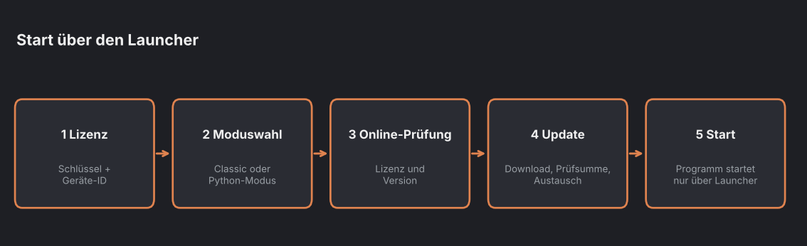

# Launcher, Lizenz und Updates

Das Programm lässt sich **nur über den Launcher** starten.

## Lizenz

- Der Launcher fragt einen **Lizenzschlüssel** ab und zeigt eine kopierbare **Geräte-ID**.
- Der Schlüssel wird bei jedem Start geprüft, indem er mit einer **Liste im Internet** abgeglichen wird. Freischaltungen können dadurch jederzeit widerrufen werden.
- Das Programm prüft Lizenz und Version zusätzlich **vor jeder Aktion** (F1, F6, F7, F8) und alle 30 Minuten.
- Ohne Internet läuft es **bis zu 48 Stunden** nach der letzten erfolgreichen Prüfung weiter.

Die Lizenzlogik selbst ist nicht Teil dieser Dokumentation.

## Programmvarianten

Der Launcher bietet zwei Varianten an: **Classic** (das ursprüngliche AutoHotkey-Programm, enthält die Nachtwache) und die **Python-Variante** (komplett neu geschrieben ab Version 3.0).

## Auto-Update

1. Beim Start fragt der Launcher die veröffentlichte Version ab (Datei `version.txt` in einem GitHub-Repository).
2. Ist eine neuere Version da, lädt er sie herunter.
3. Er prüft die **SHA-256-Prüfsumme**.
4. Er tauscht die Dateien aus, löscht die alte Version und startet neu.
5. **Pflicht-Updates** sind möglich: Eine Mindestversion sorgt dafür, dass ältere Versionen erst nach dem Update starten.

## Veröffentlichen

Der Autor veröffentlicht neue Versionen über ein eigenes Admin-Panel (Lizenzen und Releases). Dieses Panel ist nicht Teil der Kunden-Dateien.
