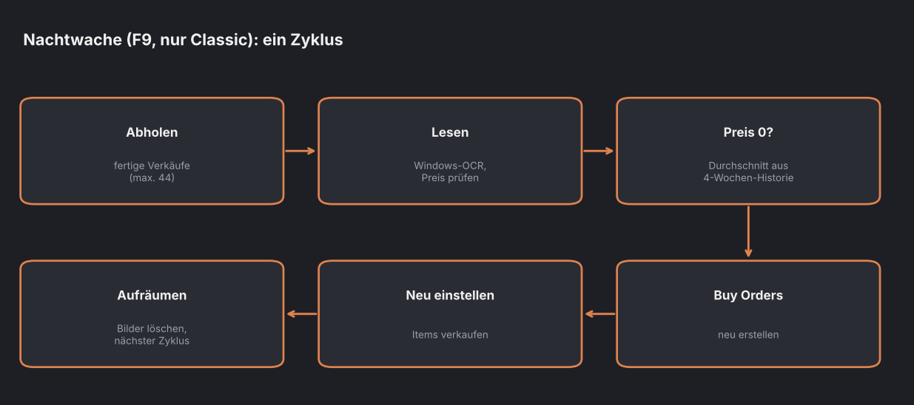

# Nachtwache (F9)

Neu in Version 3.6, **nur im Classic-Modus**. Der Marktplatz muss dabei offen bleiben.

## Was sie tut

In einstellbaren Zyklen:

1. holt sie **fertige Verkäufe** ab (rote Box, höchstens 44 pro Zyklus),
2. erstellt **Buy Orders**,
3. verkauft die Items **neu**.

Ist als Preis **0** eingetragen, setzt sie den **Durchschnittspreis aus der 4-Wochen-Historie** ein.

## Texterkennung

Die Zahlen auf dem Bildschirm liest die Nachtwache über die **Windows-OCR** (ein PowerShell-Skript). Nach jedem Zyklus werden die aufgenommenen Bilder **gelöscht**.

## Kalibrierung

Für die Nachtwache gibt es drei optionale Kalibrierschritte: Completed Transactions sowie das Verkaufsfenster mit aus- und eingeklappter Historie. Dazu liegen anonymisierte Beispielbilder bei. Siehe [Kalibrierung](kalibrierung.md).

## Einstellungen

Die Nachtwache hat eigene Einstellungen (Button im Hauptfenster), unter anderem die Zahl der Zyklen.
