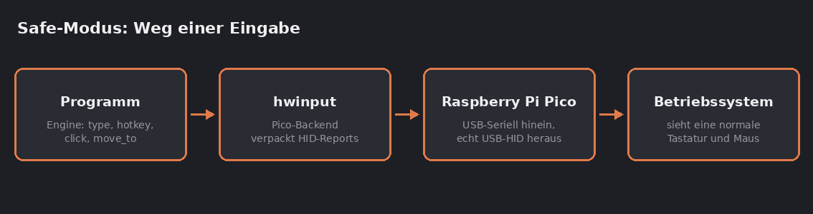

# Safe-Modus

Der Safe-Modus ist die Python-Variante des Programms. Statt die Eingaben direkt über Windows zu senden, laufen sie über einen Raspberry Pi Pico, der am PC als echte USB-Tastatur und -Maus erscheint.

## Was das bedeutet

- Kein Treiber, keine Administratorrechte, Secure Boot kann eingeschaltet bleiben.
- Der Pico erscheint dem Betriebssystem wie eine gewöhnliche Tastatur und Maus.
- Der Safe-Modus enthält nicht die Nachtwache (F9). Alle anderen Funktionen (F1 bis F8) sind vorhanden.

## Voraussetzungen

Ein Raspberry Pi Pico oder Pico 2 (USB-Kabel wird benötigt). Das Board ist handelsüblich und wird nicht mitgeliefert.

## Einrichten

1. Den Pico bei gedrückter BOOTSEL-Taste an den PC anschließen. Er erscheint als USB-Laufwerk.
2. Im Einrichtungsfenster das Laufwerk in der Liste auswählen.
3. Auf `Pico einrichten` klicken. Das Programm kopiert automatisch die Firmware und schreibt die nötigen Konfigurationsdateien.
4. Der Pico startet neu und erscheint danach als Eingabegerät.

Das Einrichtungsfenster öffnet sich automatisch, wenn der Safe-Modus gestartet wird und noch kein eingerichteter Pico gefunden wird.

## Unterschiede zum Classic-Modus

| Merkmal | Classic | Safe |
|---|---|---|
| Eingabe-Methode | Windows-API (SendInput) | Raspberry Pi Pico (USB-HID) |
| Nachtwache (F9) | ja | nein |
| Treiber nötig | nein | nein |
| Zusatz-Hardware | keine | Raspberry Pi Pico |

## Mehr dazu

Wie die Eingaben technisch an den Pico gehen, beschreibt die Seite [hwinput](hwinput.md).

## Hinweise

Nach dem Einrichten muss der Pico beim Start des Safe-Modus eingesteckt sein. Der Launcher erkennt ihn automatisch. Wird er nicht gefunden, öffnet sich das Einrichtungsfenster erneut.
