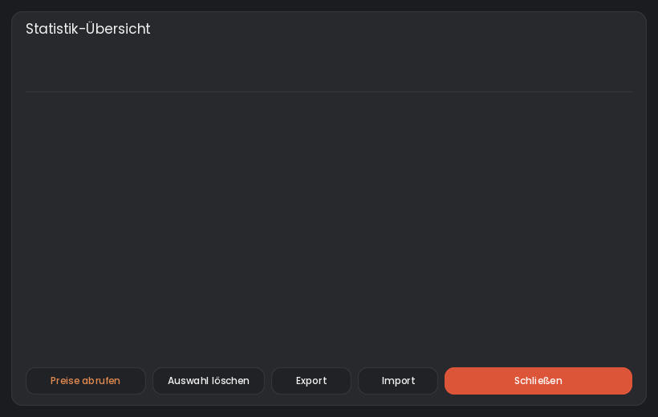

# Statistik (F5)

Das Fenster hat sechs Tabs und unten die Schaltflächen **Preise abrufen**, **Auswahl löschen**, **Export**, **Import** und **Schließen**.

| Tab | Inhalt |
|---|---|
| **Wühlkasse** | Ergebnisse der Kauf-Läufe |
| **Verscherbel-Chronik** | Läufe von Beute verscherbeln, mit Umsatz |
| **Kreislauf-Kapriolen** | Läufe des Schnapp-Kreislaufs |
| **Revierkarte** | Auswertung der Spiel-Mails pro Markt |
| **Beute-Charts** | Alle Items nach Tier und Verzauberung, meistgekaufte zuerst |
| **Updatelog** | Versionsverlauf, aus der Datei `updatelog.txt` |

Die Läufe zeigen Spalten wie Operation, Stadt, Dauer, Tempo (Items pro Minute), Items und Silber.

## Revierkarte

Sie wird aus den Spiel-Mails aufgebaut: Käufe, Ausgaben, Verkäufe, Umsatz und Unerfüllt. Eine Spalte **Saldo** zeigt Umsatz minus Ausgegeben, also den reinen Gewinn. Per Doppelklick wählt man einen Markt und sieht dann alle Tage dieses Marktes einzeln. Portal-Städte und Dens zählen zum Stadtmarkt.

## Gewinn-Ranking

Umsatz minus Kaufpreis der verkauften Stück. Berücksichtigt werden nur Items, für die ein Kaufpreis vorliegt.

## SAT-Anbindung

Das **Statistics Analysis Tool** liefert die Dateien `Trades.json` und `Market.json`. Das Programm findet den Ordner automatisch, er lässt sich aber auch in den Einstellungen wählen. Preise nach Kauf-Läufen kommen zuerst aus Market.json, danach aus dem Data Project.

## Mail-Archiv

Die Datei `stats_archive.csv` sichert die Mail-Auswertung. Die Statistik bleibt erhalten, auch wenn das SAT seine eigenen Daten leert.

## Löschen und Ausblenden

- In Wühlkasse und Chroniken werden Zeilen **endgültig** gelöscht.
- In Revierkarte und Charts werden Zeilen **ausgeblendet** und lassen sich wiederherstellen.
- Rechtsklick auf die Liste: Auswahl löschen oder Ausgeblendetes wiederherstellen.

## Export und Import

Alle Statistiken (Läufe, Mails, Ausgeblendetes) lassen sich in eine Textdatei exportieren und wieder importieren. Das dient als Sicherung und zum Umzug auf einen anderen PC.

## Begriffe

- **Umsatz:** Erlös netto (früher „Erlös (netto)“)
- **Saldo:** Umsatz minus Ausgegeben
- **Wühlkasse:** die Kasse aus den Kauf-Läufen
